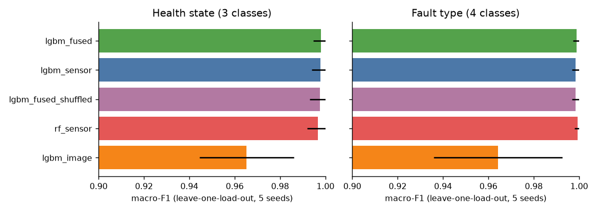
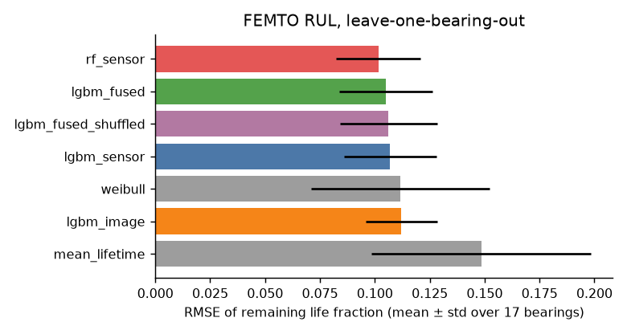
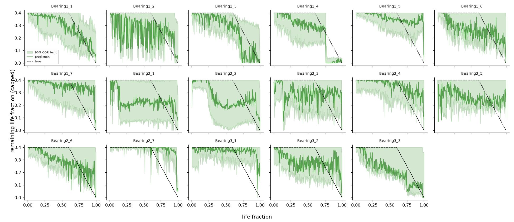
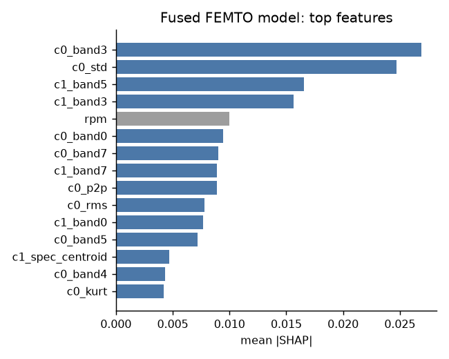
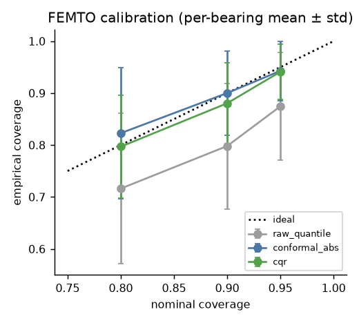
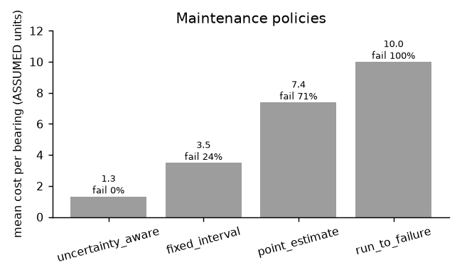
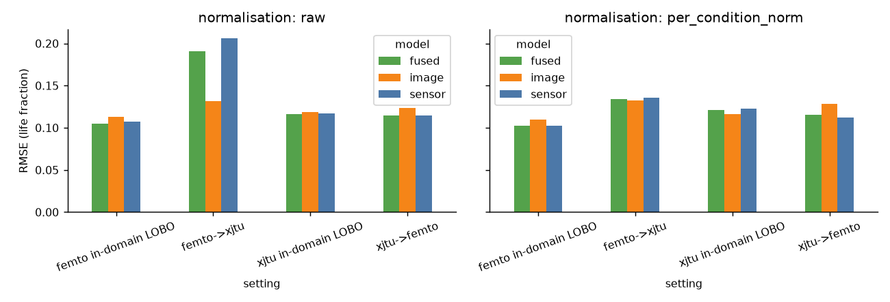
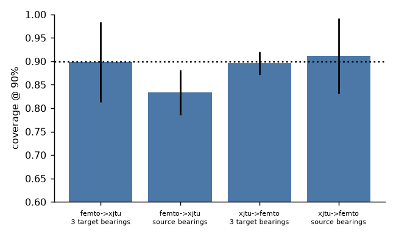
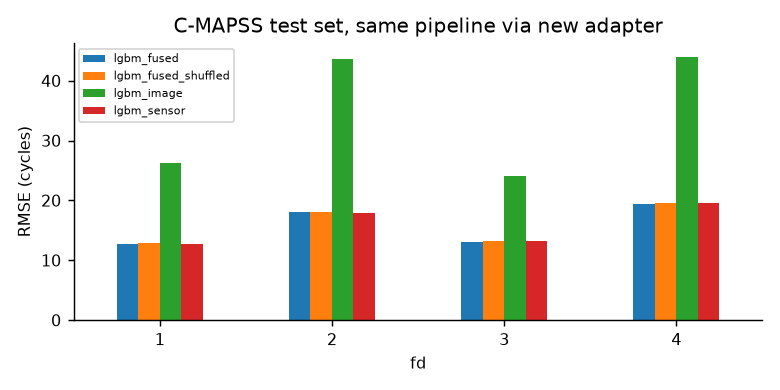

# Multimodal, uncertainty-aware predictive maintenance for rolling bearings

*Minor project, NITK. All numbers below are generated from `reports/tables/*.csv` by `scripts/make_report.py`; run configs, seeds and git state are in `reports/runs/*.json`. Costs in the decision layer are **assumptions**, not measurements.*

## 1. Problem
For a rolling-element bearing we ask three questions: (1) which health state is it in (healthy / early / severe), (2) how much life remains, with a calibrated interval, and (3) should we maintain now, schedule, or continue. We test whether fusing signal-derived time-frequency images with engineered features helps (RQ1), whether intervals reach nominal coverage (RQ2), how much is lost across datasets (RQ3) and whether the same pipeline runs on a turbofan (RQ4).

## 2. Mechanics background (course notes)
Rolling bearings fail by contact fatigue (spalling) even when well lubricated; identical bearings show different lives, hence a statistical treatment: rating life L10 is the life 90% of a group reaches, L50 = 5 L10, L = (C/P)^3 for ball bearings and Lh = 10^6 L10 / (60 N). Reliability follows ln(1/R) = (L/a)^b with a = 6.84, b = 1.17, which motivates the Weibull baseline and uncertainty quantification. Nominal life scales as load^-3 and 1/speed, so operating condition is always a covariate or a split variable. Petroff's equation, the Sommerfeld number and McKee's analysis belong to **journal** bearings and are background only; no feature uses them.
**Two source notes** (details in `docs/mechanics_notes.md`): the slide prints 8.85 as the L/L90 coefficient, but a = 6.84 and b = 1.17 give 6.84 (unit-tested); and CLAUDE.md's BSF formula is half of CWRU's published ball-defect value (2 x BSF matches it).

## 3. Data
{{table:data_audit}}

* **CWRU** 12 kHz drive-end: 64 files (4 normal, 60 faulty), fault-labelled only (not run-to-failure). Health state is an assumption: Normal = healthy, 0.007 in = early, 0.014/0.021 in = severe.
* **FEMTO/PRONOSTIA**: 17 full run-to-failure bearings (6 learning set + 11 full test set), 2 channels, 25.6 kHz, 0.1 s snapshot every 10 s. Each bearing is thinned to at most 300 evenly spaced windows to keep CPU cost low (whole life kept). Temperature files were **not** used (limitation).
* **XJTU-SY**: 15 bearings, 25.6 kHz, 1.28 s per minute; the centre 2560 samples of each snapshot are used so windows match FEMTO.
* **C-MAPSS** FD001-FD004, 30-cycle windows.
* **Bearing geometry**: only CWRU's 6205 geometry is used (envelope energy at BPFO/BPFI/BSF/FTF and harmonics), flagged `verified: false` in `configs/datasets.yaml` because the source page could not be fetched in this session. FEMTO and XJTU geometry is `null` (not found in retrievable sources); those datasets use generic envelope bands instead.

## 4. Methods
Sensor branch: RMS, std, skew, kurtosis, crest factor, peak-to-peak, 8 band energies, spectral entropy/centroid, envelope-spectrum energy per channel. Image branch: STFT (FEMTO, XJTU) or CWT (CWRU) image at 224x224 -> frozen ResNet18 (ImageNet weights, no fine-tuning) -> PCA (16 components, fit on training bearings only). **These images are derived from the vibration signal itself ("multi-representation fusion"), not photographs.** Fusion = concatenation -> LightGBM. Controls: sensor-only, image-only, Random Forest, mean-lifetime and Weibull baselines, and fused with *shuffled* embeddings (images no longer belong to their window).
RUL target: remaining life fraction, flat at 0.4 until 60% of life (onset defined by a life-fraction threshold, not by RMS first-prediction-time) and linear afterwards. Health states: <60% / 60-90% / >90% of life. Uncertainty: quantile LightGBM (alpha/2, 1-alpha/2), split-conformal with absolute residuals, and conformalised quantile regression (CQR); the calibration set is 4 bearings held out of both training and testing. Decision: expected-cost rule over maintain-now / schedule / continue using a normal approximation of the interval (`configs/costs.yaml`).

## 5. Evaluation protocol
Splits are by group, never by window: leave-one-load-out (CWRU), leave-one-bearing-out (FEMTO), source-vs-target dataset (cross-dataset), official train/test engines (C-MAPSS). Scalers and PCA are fit on training rows only, and unit tests fail if a group id appears in two splits (`tests/`). Metrics: macro-F1, per-class recall, confusion matrix; RMSE, MAE, mean NASA score (late penalised more, computed on percent-of-life); empirical vs nominal coverage and width. Five seeds; per-bearing means are compared with paired Wilcoxon tests.

## 6. Results

### 6.1 RQ1: does fusion help?
**Classification (CWRU, leave-one-load-out).**

{{table:cwru_classification_summary}}
{{table:cwru_classification_wilcoxon}}
Every sensor-based model is near ceiling (macro-F1 about 0.998-0.999). Fusion is not distinguishable from sensor-only or from fused-with-shuffled-images (p = 0.18 for health state). Image-only is clearly worse (about 0.965, p < 1e-4). Caveat: CWRU holds the same physical specimens at every load, so leave-one-load-out does not test unseen bearing instances; this saturation is a known property of the dataset.

**RUL (FEMTO, leave-one-bearing-out, 17 bearings x 5 seeds).**

{{table:femto_rul_summary}}
{{table:femto_rul_wilcoxon}}
Fused LightGBM beats sensor-only by 0.002 RMSE (p = 0.008): statistically detectable but practically negligible. It is not better than the sensor-only Random Forest (p = 0.22) or the Weibull baseline in RMSE (p = 0.58), and the shuffled-image control is almost as good (p = 0.051), so most of the fused model's skill comes from the sensor features and operating-condition covariates, not from the image content. The Weibull baseline has the lowest MAE but a much higher NASA score (the asymmetric score penalises its errors more). All learned models clearly beat the mean-lifetime baseline. **Conclusion: on these data fusion gives at best a marginal gain; the hypothesis that images add substantial information is not supported.**

{{table:femto_error_by_life}}
Error grows late in life: FEMTO bearings often fail abruptly, so degradation is hard to see far ahead (see per-bearing plots above).

**Explainability.** Summed mean |SHAP|: sensor features dominate; the image embedding and operating condition contribute roughly an order of magnitude less.
{{table:shap_modality}}

### 6.2 RQ2: do intervals reach nominal coverage?
{{table:femto_coverage_summary}}

Raw quantile regression under-covers (about 0.80 at nominal 0.90). Split-conformal with absolute residuals reaches nominal coverage (0.82 / 0.90 / 0.94 at 0.80 / 0.90 / 0.95) and CQR is close with narrower intervals at 80% and 90% (0.80 / 0.88 / 0.94). Spread across bearings is large (std 0.05-0.13): coverage is marginal, not per-bearing, and windows within a bearing are autocorrelated, so the exchangeability assumption is only approximate.

**Decision layer (assumed costs).**
{{table:femto_decision_summary}}

With the assumed costs (failure 10x a planned stop), the interval-aware rule avoids all failures in this replay and is cheapest; a point-estimate version of the same rule fails on 12 of 17 bearings, which shows why the interval matters. The absolute numbers depend entirely on the assumed costs.

### 6.3 RQ3: cross-dataset (FEMTO <-> XJTU-SY)
{{table:generalisation}}

Training on FEMTO and testing on XJTU-SY with raw features degrades the sensor and fused models strongly (RMSE about 0.19-0.21 vs about 0.12 in-domain), while the image model degrades less (0.13). Per-condition normalisation (label-free z-scoring within each dataset/condition) removes most of the loss for the sensor and fused models (about 0.134-0.136). The reverse direction (XJTU to FEMTO) is close to in-domain in both settings (about 0.112-0.129). Note the cross-dataset models have no operating-condition covariates, since conditions do not overlap between datasets.
{{table:generalisation_coverage}}

Under shift, conformal intervals calibrated on source bearings undercover FEMTO->XJTU (0.83 vs 0.90 nominal); recalibrating with 3 labelled target bearings restores about 0.90 in both directions (at the cost of wider intervals for FEMTO->XJTU).

### 6.4 RQ4: C-MAPSS through a new adapter
Only `build_features.cmapss` (the adapter: 30-cycle sensor windows -> features and a sensor-heatmap image) differs; the featurizer, models, conformal and evaluation code are reused. Target: RUL capped at 125 cycles, official test last-window labels.
{{table:cmapss_summary}}
{{table:cmapss_coverage}}

| Component | Transfers? |
|---|---|
| Feature/fusion/LightGBM code, split-by-engine, metrics | unchanged |
| Split-conformal 90% intervals | unchanged, coverage 0.88-0.93 |
| Sensor features | retuned (per-sensor last/mean/std/slope replaces vibration statistics) |
| Image branch | **failed**: image-only RMSE is 1.8-2.4x worse than sensors, and fusion adds nothing (fused ≈ sensor ≈ shuffled). Per-window min-max heatmaps discard absolute sensor level. |
| Decision layer | not run (RUL in cycles; the decision units are life fractions) |

## 7. Limitations
* Images are signal-derived; the image branch is a re-encoding of the same vibration, so little new information is expected. No surface-defect images were used.
* Costs in the decision layer are invented; the policy ranking is not evidence about real savings.
* FEMTO/XJTU geometry unavailable, so fault-frequency features exist only for CWRU, and CWRU geometry is flagged unverified.
* Windows were thinned to at most 300 per bearing; temperature data unused; one CNN (ResNet18) and one image type per dataset were tried.
* Accelerated-test conditions are far above rating loads, so L10 relations are only a qualitative prior. XJTU operating conditions and FEMTO conditions are taken from dataset descriptions (`conditions_verified: false`).
* RUL targets are in life fractions (needed for cross-dataset comparison); converting to time requires an estimate of total life.
* Calibration uses 4 bearings; coverage varies a lot between bearings. Wilcoxon tests use 17 (FEMTO) paired bearings; CWRU tests pair (load, seed) combinations and are therefore optimistic.

## 8. Future work
Verify geometry from the original papers and add FEMTO/XJTU fault-frequency features; use temperature; tune the onset with an RMS first-prediction time; try fine-tuned CNNs or LSTM baselines; conformal methods robust to autocorrelation; calibrate costs with a maintenance partner.

## 9. Reproduce
`make setup data features eval test app` (see README). Run records: `reports/runs/`.
